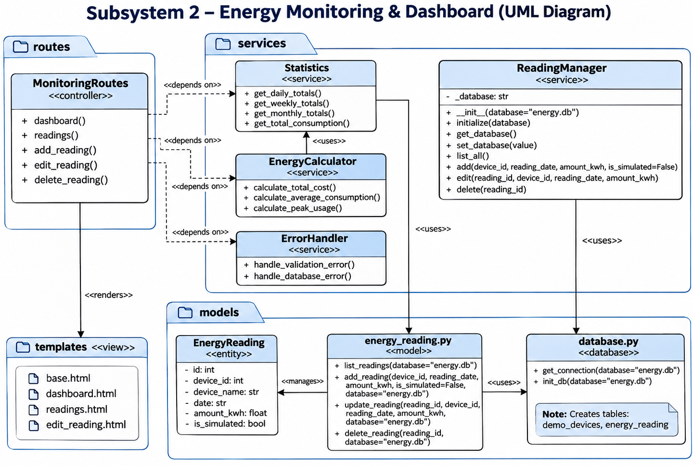

# AI-Powered Smart Energy Management System

## Team Members & Roles
- **Wajihah Kainat** - Subsystem 3: Cost, Savings, Carbon & Score
- **Arshia Fatima** - Subsystem 1: User & Building Management
- **Faryal Mahmood** - Subsystem 4: AI Sustainability Coach & Reports
- **Melika Soheylifar** - Subsystem 2: Energy Monitoring & Dashboard

## Technology Stack
Python, Flask, SQLite, HTML/CSS, Chart.js, OpenAI API, pytest, Docker.

## Subsystem 3: Cost, Savings, Carbon & Score
### Uml Diagram

## Subsystem 1: User & Building Management 
### Uml Diagram

## Subsystem 2: Energy Monitoring & Dashboard
## UML Class Diagram

