# AI-Powered Smart Energy Management System

A web application that helps owners of offices, universities and homes to **monitor their energy use, understand cost and carbon, reach savings goals, and get tips from an AI coach**. It was built as the Python Capstone Project at the University of Applied Sciences and Arts Dortmund (FH Dortmund), course of Prof. Galyna Tabunshchyk.

The project has four subsystems (S1 to S4). They are one website with **one login, one database and one design**: the data entered in one subsystem is used by the next one, and nothing has to be typed twice.

> **Quick start:** `pip install -r requirements.txt`, then `python seed_demo.py` (optional demo data), then `python run.py`, then open <http://localhost:5000>. Without an OpenAI key everything works; the AI coach then shows built-in tips (see [OpenAI](#7-ai-coach-and-the-openai-key)).

## Table of contents

1. [Team and roles](#1-team-and-roles)
2. [Features](#2-features)
3. [Technologies](#3-technologies)
4. [Screenshots](#4-screenshots)
5. [Installation and running](#5-installation-and-running)
6. [Environment variables](#6-environment-variables)
7. [AI coach and the OpenAI key](#7-ai-coach-and-the-openai-key)
8. [Docker](#8-docker)
9. [System architecture and data flow](#9-system-architecture-and-data-flow)
10. [Project structure](#10-project-structure)
11. [Database](#11-database)
12. [UML diagrams](#12-uml-diagrams)
13. [Pages and routes](#13-pages-and-routes)
14. [Formulas](#14-formulas)
15. [Testing](#15-testing)
16. [Requirements status](#16-requirements-status)
17. [Security](#17-security)
18. [Known limitations and future improvements](#18-known-limitations-and-future-improvements)
19. [Troubleshooting](#19-troubleshooting)
20. [Screencast and presentation](#20-screencast-and-presentation)

---

## 1. Team and roles

| Subsystem | Team member | Responsibility |
|---|---|---|
| **S1** User and Building Management | Arshia Fatima | Registration, login, buildings, devices, comfort temperature, access rules |
| **S2** Energy Monitoring and Dashboard | Melika Soheilifar | Energy readings, live simulation, CSV export, dashboard with charts |
| **S3** Cost, Savings, Carbon and Score | Wajihah Kainat | Price and carbon factor, cost, carbon, sustainability score, goals, alerts |
| **S4** AI Coach and Reports | Faryal Mahmood | OpenAI coach, reports, PDF download |

Repository: <https://github.com/Wajihah-Kainat/Smart-energy-management>

Each member built their subsystem on their own branch. The `master` branch contains the integrated project (this README).

## 2. Features

### S1 User and Building Management
- Register with name, email and password (password at least 8 characters, valid email, each email only once).
- Log in and log out (session cookie). All other pages need a login.
- Add, edit and delete **buildings** (name, address, type: office / university / home, comfort temperature 10 to 30 °C, empty = 21 °C).
- Add, edit and delete **devices** of a building (name, energy type: electricity / gas / solar).
- A user sees only their own data; foreign ids give a "404 not found".

### S2 Energy Monitoring and Dashboard
- Add, edit and delete **energy readings** (device, date, kWh). The device comes from the buildings of S1.
- Filter readings by device and date range; export the filtered list as **CSV**.
- **Live simulation:** creates one simulated reading every 10 seconds (marked "Simulated").
- **Dashboard:** total energy, number of devices (from S1), number of readings, line chart of daily consumption, and tables per day, week and month. It can be limited to one building.

### S3 Cost, Savings, Carbon and Score
- Set price per kWh, emission factor (kg CO₂ per kWh) and the source of the factor for each building.
- Calculates **cost** and **carbon** from the kWh of the S2 readings.
- **Monthly goal** (kWh) with progress in percent, and a **daily limit** (kWh) for alerts.
- **Sustainability score** from 0 to 100 (see [Formulas](#14-formulas)).
- **Alerts:** an alert is created when a day is above the daily limit; alerts can be marked as read or deleted.
- A JSON API (see [API table](#api-of-s3)) is used by the page and can be called directly.

### S4 AI Coach and Reports
- **AI Coach:** gives one short saving tip for a building and a month, using OpenAI (gpt-4o-mini). Without a key it gives a built-in tip and says so.
- The coach sees only a short summary (building type, comfort temperature, energy of the month, change against the month before, goal progress). **No name, email or address is sent.**
- **Reports:** create a report for a building and a month (kWh, cost, carbon from S2 and S3), list the reports, download a **PDF** (with goal progress, score and the coach tip), delete reports.

### What is connected (nothing is typed twice)
| Value | Entered in | Used by |
|---|---|---|
| Logged-in user | S1 login | every page; owner of all data |
| Buildings, devices, comfort temperature | S1 Buildings | dropdowns in S2, S3, S4; coach; PDF |
| kWh readings | S2 Readings | S2 dashboard; S3 cost, carbon, goal, alerts, score; S4 coach and reports |
| Price, emission factor, goal, daily limit | S3 Costs & Carbon | S3 results; S4 reports and coach |

## 3. Technologies

| Part | Technology |
|---|---|
| Language | Python 3 (Docker image uses 3.12; tested with Python 3.13) |
| Web framework | Flask 3.1.3 (application factory, Blueprints, Jinja2 templates, sessions) |
| Database | SQLite (`sqlite3` module, one file `energy.db`) |
| Frontend | HTML, CSS (one shared stylesheet), JavaScript, Chart.js 4.4.7 (included in `app/static/vendor`, no internet needed) |
| AI | OpenAI API, model `gpt-4o-mini` (Python package `openai`) |
| PDF | reportlab |
| Passwords | werkzeug password hashing (comes with Flask) |
| Tests | pytest 9.2.0 |
| Container | Docker |

## 4. Screenshots

Taken with the demo data from `seed_demo.py` (no OpenAI key set).

| | |
|---|---|
| **Login** 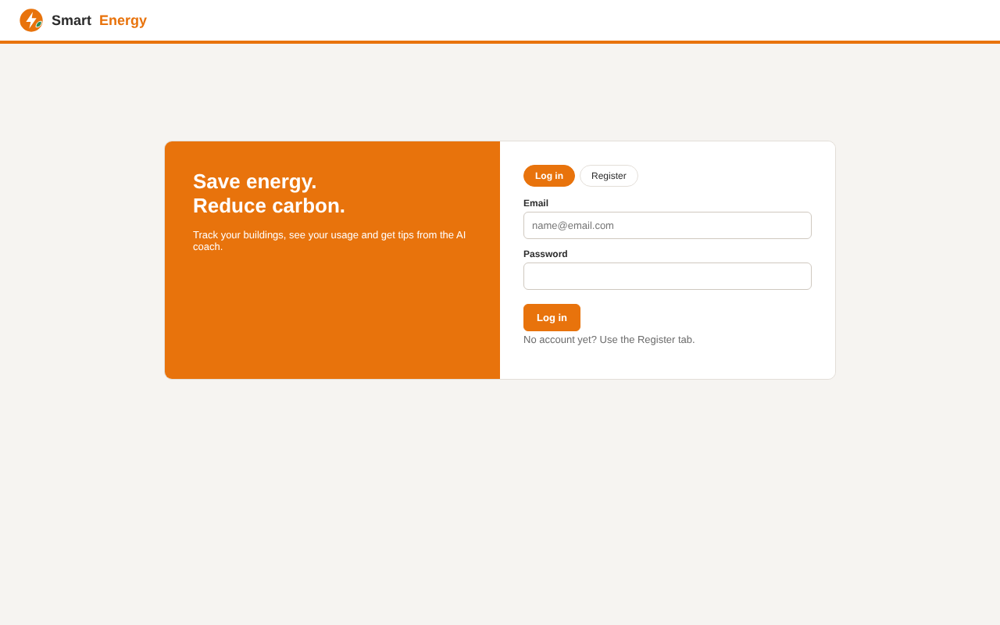 | **Register** 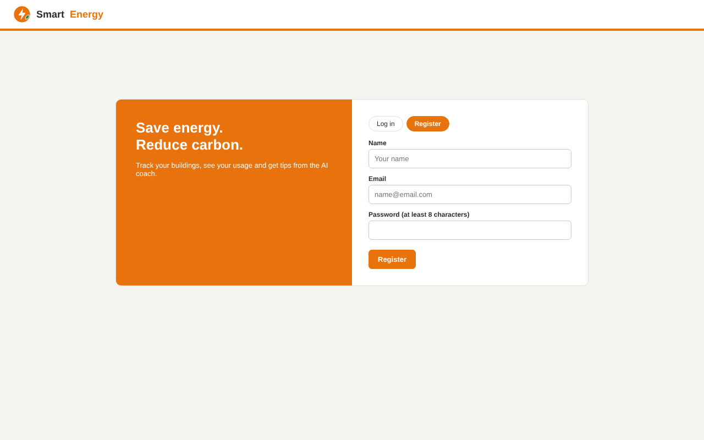 |
| **Buildings (S1)** 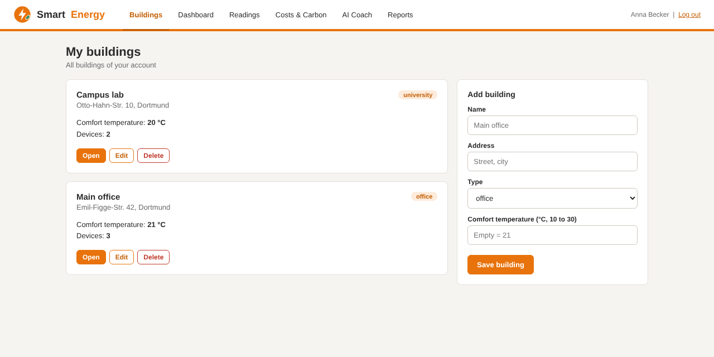 | **Building details and devices (S1)** 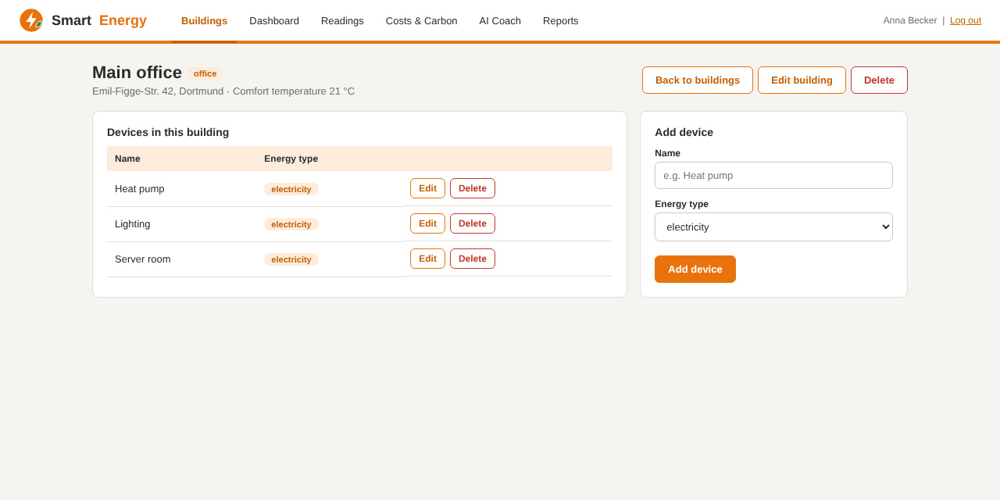 |
| **Dashboard (S2)** 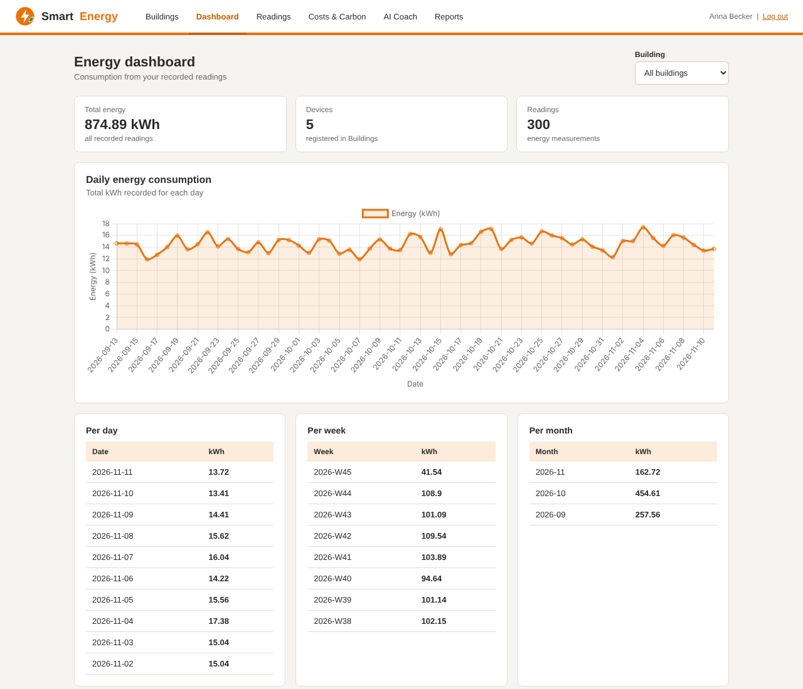 | **Readings (S2)** 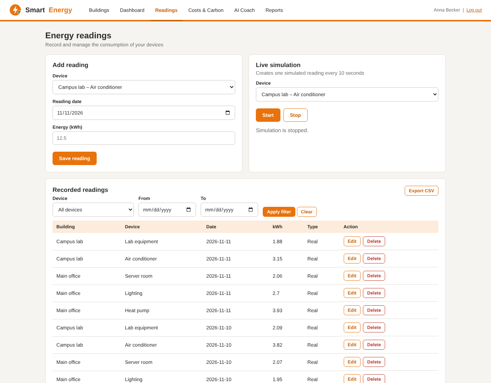 |
| **Costs and carbon (S3)** 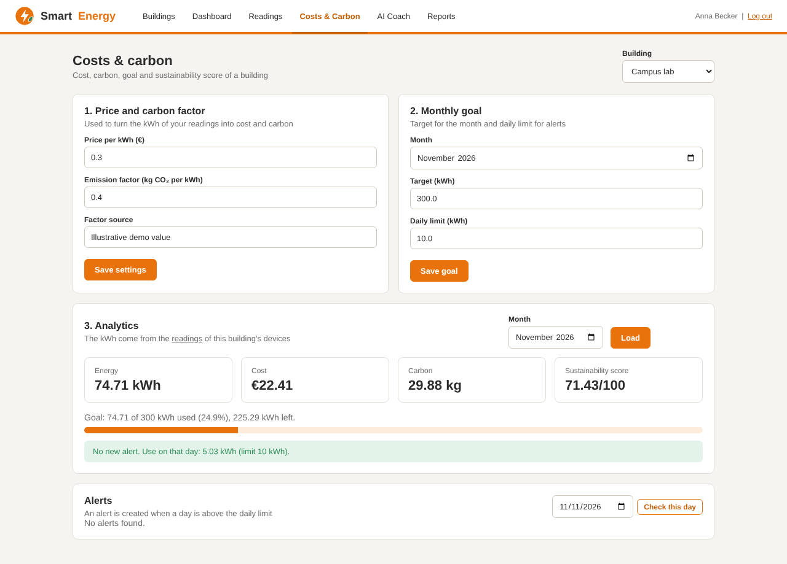 | **AI Coach (S4)** 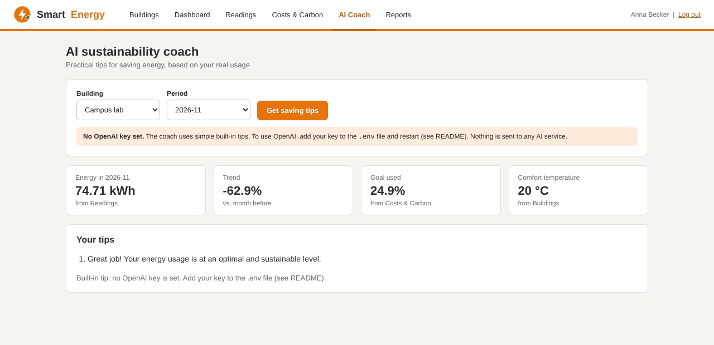 |
| **Reports (S4)** 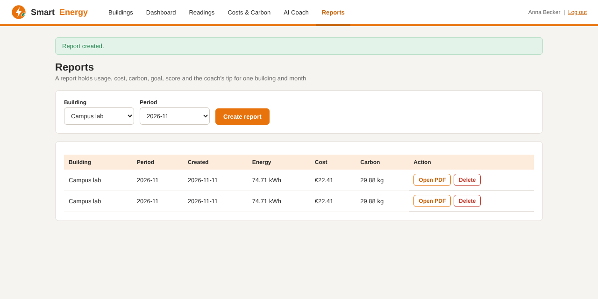 | |

## 5. Installation and running

You need **Python 3.12 or newer** and `pip`. Open a terminal (Windows: cmd or PowerShell) in the project folder, the folder that contains `run.py`.

```bash
# 1. get the project
git clone https://github.com/Wajihah-Kainat/Smart-energy-management.git
cd Smart-energy-management

# 2. (optional but recommended) virtual environment
python -m venv venv
venv\Scripts\activate          # Windows
# source venv/bin/activate     # macOS / Linux

# 3. install the libraries
pip install -r requirements.txt

# 4. optional: demo data (user, 2 buildings, 5 devices, 60 days of readings, settings, goals)
python seed_demo.py

# 5. start the website
python run.py
```

Open <http://localhost:5000>.

- With the demo data: log in with **demo@example.com / demo12345**.
- Without the demo data: click **Register** and create your own user.
- Stop the server with `Ctrl + C`.
- The database file `energy.db` is created in the project folder at the first start. To start again from zero, stop the app and delete `energy.db`.

## 6. Environment variables

| Variable | Meaning | Default |
|---|---|---|
| `OPENAI_API_KEY` | Key for the AI coach. Without it the coach uses built-in tips. | not set |
| `SECRET_KEY` | Signs the login cookie. **Set your own value outside of development.** | `dev-only-change-me` |
| `DATABASE` | Path of the SQLite file | `energy.db` (Docker: `/data/energy.db`) |

Variables can be set in the terminal or in a file named `.env` in the project folder (see next section). A variable that is already set in the terminal is not overwritten by `.env`.

## 7. AI coach and the OpenAI key

The coach uses the OpenAI API with the model `gpt-4o-mini`. **The key is never stored in the code or on GitHub** (the file `.env` is in `.gitignore`).

1. Create a key at <https://platform.openai.com> (API keys). The API needs a small prepaid credit; a ChatGPT subscription is a separate product and does not include API credit.
2. In the project folder copy `.env.example` to `.env` (Windows: `copy .env.example .env`).
3. Open `.env` and write the key after `OPENAI_API_KEY=` (no spaces, no quotes).
4. Start the app (`python run.py`). It reads `.env` by itself.

Instead of `.env` you can set the variable in the terminal:
```bash
set OPENAI_API_KEY=sk-...        # Windows cmd
$env:OPENAI_API_KEY="sk-..."     # Windows PowerShell
export OPENAI_API_KEY=sk-...     # macOS / Linux
```

A label under each tip on the AI Coach page shows where the tip came from:

| Label | Meaning |
|---|---|
| Tip by OpenAI (gpt-4o-mini) | OpenAI answered |
| Built-in tip: no OpenAI key is set | No key found; simple rules were used and nothing was sent to any AI service |
| OpenAI could not be reached | A key is set but the request failed (wrong key, no credit, no internet, limit) |

**Rules of the built-in tip** (checked in this order): no energy in the month → "no readings found"; goal used above 100 % → warning about the goal; usage more than 10 % higher than the month before → warning about the trend; average of more than 20 kWh per day → "usage is high" (mentions the comfort temperature); otherwise a positive message.

Everything else in the website works without a key. The tests use a fake OpenAI, so they never send real requests.

## 8. Docker

The `Dockerfile` builds one image with the whole website (S1 to S4).

```bash
# build the image (run in the project folder)
docker build -t smart-energy .

# run it; the database is kept in the volume "energy-data"
docker run -p 5000:5000 -v energy-data:/data smart-energy
```

Open <http://localhost:5000>. Optional settings:

```bash
docker run -p 5000:5000 -v energy-data:/data --env-file .env -e SECRET_KEY=my-own-secret smart-energy
```

- `--env-file .env` passes the OpenAI key into the container. The `.env` file itself is **not** copied into the image (`.dockerignore`).
- To create the demo data inside the container: `docker exec -it <container-name> python seed_demo.py` (find the name with `docker ps`).

## 9. System architecture and data flow

```
Browser (HTML, CSS, Chart.js)
        |
Flask application  (app/__init__.py: create_app)
  |-- S1 Blueprint "s1"          login, buildings, devices
  |-- S2 Blueprint "monitoring"  dashboard, readings, CSV, simulation
  |-- S3 Blueprint "s3"          costs & carbon page + JSON API
  |-- S4 Blueprint "s4"          coach, reports, PDF
        |
SQLite database (one file, one connection per request: app/db.py)         OpenAI API (external, only S4)
```

Data flow:

```
S1 user -> buildings -> devices
                           |   every reading belongs to a device
S2 readings (kWh) ---------+
        |   kWh of a building = sum of the readings of its devices
S3 price + carbon factor, goal  ->  cost, carbon, score, alerts
        |
S4 coach and reports use  S1 (building)  +  S2 (kWh)  +  S3 (cost, carbon, goal, score)
```

How the subsystems are connected in code:
- **One application:** `create_app()` registers the four Blueprints and opens one database (`app/db.py`, `get_db()`).
- **S1 → all:** `login_required` and `g.user` (the logged-in user) are used by S2, S3 and S4. A user's data is found through `devices → buildings → user_id`.
- **S2:** `energy_reading.device_id` points to the `devices` table of S1. Every S2 query is limited to the logged-in user.
- **S3:** has no readings of its own. It sums the S2 readings of a building with an SQL `JOIN`. It checks that the building belongs to the user (otherwise 404).
- **S4:** gets the building from S1, the monthly kWh from S2 (`Statistics`), and cost, carbon, goal and score from S3 (`services` and `models`).

The architecture diagram is in [UML diagrams](#12-uml-diagrams).

## 10. Project structure

```
.
├── run.py                  starts the web server (port 5000)
├── seed_demo.py            creates demo data
├── requirements.txt        Python libraries
├── Dockerfile              image for the whole project
├── .env.example            template for the OpenAI key (copy to .env)
├── .gitignore / .dockerignore
├── README.md
├── app/
│   ├── __init__.py         create_app(): settings, Blueprints, .env loader
│   ├── db.py               get_db(), close_db(), init_db()
│   ├── schema.sql          all tables of the project
│   ├── s1.py               S1: login, buildings, devices
│   ├── s2/                 S2: Energy Monitoring and Dashboard
│   │   ├── database.py       connection helper and shared SQL
│   │   ├── models/           energy_reading.py (database functions), energy_reading_class.py (class EnergyReading)
│   │   ├── services/         energy_calculator.py (totals), statistics.py, reading_manager.py, error_handler.py
│   │   ├── dashboard/        dashboard.py (class Dashboard)
│   │   └── routes/           monitoring.py (all S2 pages)
│   ├── s3/                 S3: Cost, Savings, Carbon and Score
│   │   ├── models.py         the domain classes
│   │   ├── services.py       use cases (database + classes)
│   │   ├── routes.py         page and JSON API
│   │   └── errors.py         AppError
│   ├── s4/                 S4: AI Coach and Reports
│   │   ├── __init__.py       routes (coach, reports, PDF)
│   │   ├── models.py         DatabaseManager, AICoachService, ReportGenerator
│   │   └── data.py           collects the numbers from S1, S2, S3
│   ├── templates/          base.html, login, buildings, building_detail, s2/, s3/, s4/
│   └── static/             style.css, logo.svg, s3.js, vendor/chart.umd.js
├── tests/                  pytest tests (73)
└── docs/
    ├── screenshots/        pictures used in this README
    └── uml/                UML diagrams as pictures
```

## 11. Database

One SQLite file (`energy.db`). The tables are created from `app/schema.sql` when the app starts (`CREATE TABLE IF NOT EXISTS`). Foreign keys are switched on for every connection.

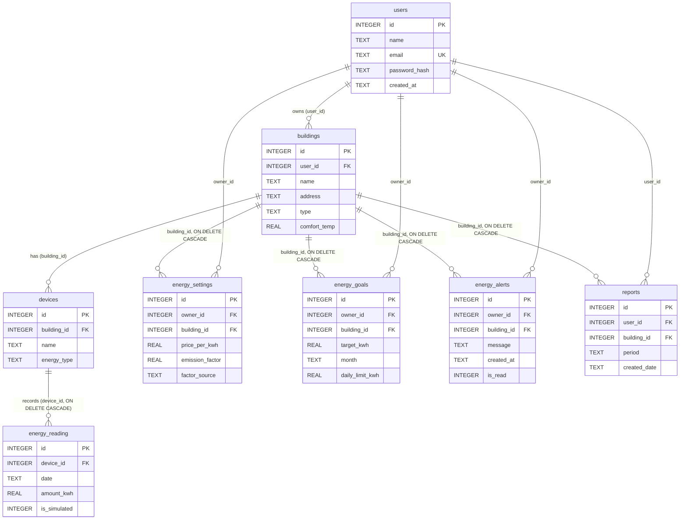

### Tables

**`users`** (S1): the people who can log in.

| Column | Type | Meaning |
|---|---|---|
| id | INTEGER, primary key | |
| name | TEXT, required | |
| email | TEXT, required, **unique** | stored in lower case |
| password_hash | TEXT, required | hash, never the password |
| created_at | TEXT, required | date `YYYY-MM-DD` |

**`buildings`** (S1)

| Column | Type | Meaning |
|---|---|---|
| id | INTEGER, primary key | |
| user_id | INTEGER, foreign key → users | owner |
| name, address | TEXT, required | |
| type | TEXT, required | `office`, `university` or `home` |
| comfort_temp | REAL, required | °C, 10 to 30 (default 21) |

**`devices`** (S1)

| Column | Type | Meaning |
|---|---|---|
| id | INTEGER, primary key | |
| building_id | INTEGER, foreign key → buildings | |
| name | TEXT, required | |
| energy_type | TEXT, required | `electricity`, `gas` or `solar` |

**`energy_reading`** (S2): one measurement of one device.

| Column | Type | Meaning |
|---|---|---|
| id | INTEGER, primary key | |
| device_id | INTEGER, foreign key → devices, `ON DELETE CASCADE` | |
| date | TEXT, required | `YYYY-MM-DD` |
| amount_kwh | REAL, required, **greater than 0** | always kWh |
| is_simulated | INTEGER, 0 or 1 | 1 = created by the live simulation |

**`energy_settings`** (S3): price and carbon factor, one row per user and building.

| Column | Type | Meaning |
|---|---|---|
| id | INTEGER, primary key | |
| owner_id | INTEGER, foreign key → users | |
| building_id | INTEGER, foreign key → buildings, `ON DELETE CASCADE` | |
| price_per_kwh | REAL, 0 or more | € per kWh |
| emission_factor | REAL, 0 or more | kg CO₂ per kWh |
| factor_source | TEXT, required | where the factor comes from |

Unique: (owner_id, building_id).

**`energy_goals`** (S3): monthly goal and daily limit, one row per user, building and month.

| Column | Type | Meaning |
|---|---|---|
| id | INTEGER, primary key | |
| owner_id, building_id | foreign keys (building: `ON DELETE CASCADE`) | |
| target_kwh | REAL, greater than 0 | goal for the month |
| month | TEXT | `YYYY-MM` |
| daily_limit_kwh | REAL, greater than 0 | alert threshold per day |

Unique: (owner_id, building_id, month).

**`energy_alerts`** (S3)

| Column | Type | Meaning |
|---|---|---|
| id | INTEGER, primary key | |
| owner_id, building_id | foreign keys (building: `ON DELETE CASCADE`) | |
| message | TEXT, required | |
| created_at | TEXT, required | date of the day that was too high |
| is_read | INTEGER, 0 or 1 | |

**`reports`** (S4)

| Column | Type | Meaning |
|---|---|---|
| id | INTEGER, primary key | |
| user_id | INTEGER, foreign key → users | |
| building_id | INTEGER, foreign key → buildings, `ON DELETE CASCADE` | |
| period | TEXT | month `YYYY-MM` |
| created_date | TEXT | date the report was created |

A report stores only building and period. The numbers and the PDF are calculated again from S2 and S3 when the report is shown or downloaded, so a report always shows current data.

**Deleting data:** deleting a device removes its readings. Deleting a building removes its devices (done by S1), and through them its readings, plus its settings, goals, alerts and reports.

## 12. UML diagrams

The diagrams are written in Mermaid, which GitHub shows as pictures. The same diagrams are available as PNG files in `docs/uml/`. They were checked against the code and the database (every class, method, table, column and foreign key).

### Architecture: modules and dependencies

Arrows between the subsystems are Python imports. S3 does not import S1 or S2; it reads their tables with SQL.

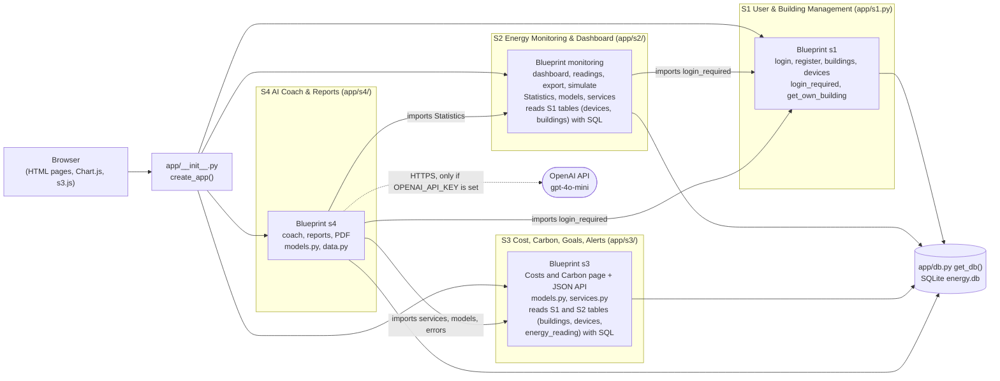

*Picture: `docs/uml/architecture.png`*

### S1 User and Building Management

S1 has no Python classes: it is a Flask Blueprint with functions (`app/s1.py`). `User`, `Building` and `Device` are the data model (database tables, see [Database](#11-database)). The functions read and write these tables.

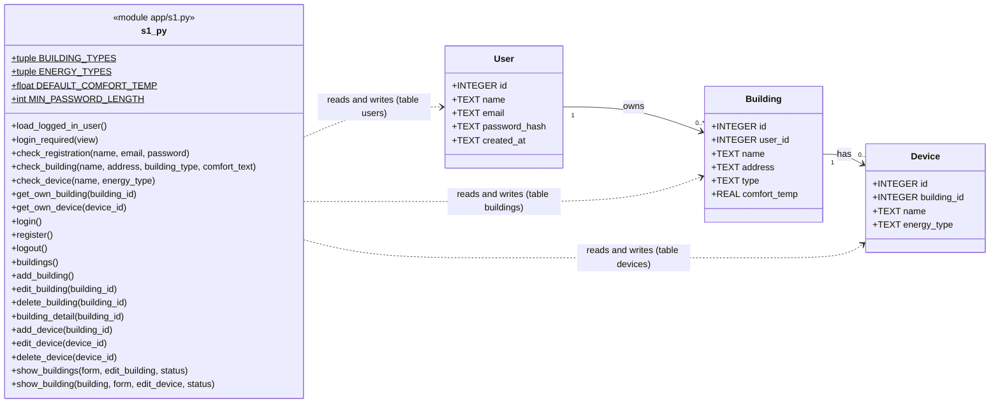

*Picture: `docs/uml/s1_model.png`*

### S2 Energy Monitoring and Dashboard

| Class | Purpose |
|---|---|
| `EnergyReading` | one reading with validated getters and setters |
| `ReadingManager` | add, edit, delete, filter and simulate readings for one user |
| `Statistics` | totals per day, week and month, total consumption, reading count, device count |
| `Dashboard` | data for the charts and CSV export |
| `EnergyMonitoringErrorHandler`, `EnergyMonitoringError` | validation of energy amount and device id |

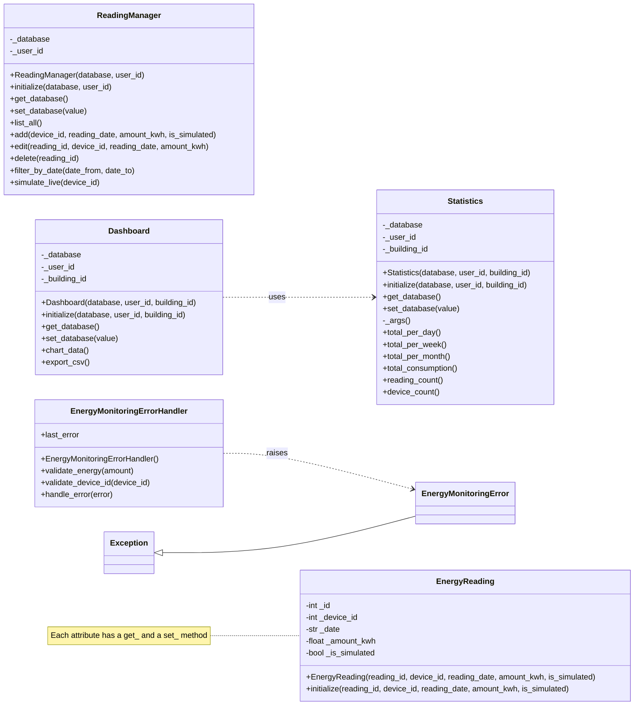

*Picture: `docs/uml/s2_classes.png`. Each attribute of `EnergyReading` has a `get_` and a `set_` method. `Statistics` is used by the dashboard page and by S4. The pages call the functions in `models/energy_reading.py` directly for adding, editing and deleting readings; `ReadingManager` and `Dashboard` (chart data, CSV export) are part of the class design but the pages do not call them.*

### S3 Cost, Savings, Carbon and Score

| Class | Purpose |
|---|---|
| `EnergySettings` | price per kWh, emission factor and its source (validated) |
| `EnergyAnalytics` | cost and carbon for an amount of energy; holds an `EnergySettings` |
| `SustainabilityScore` | score from 0 to 100 |
| `EnergyGoal` | monthly target and daily limit; progress and limit check |
| `EnergyAlert` | an alert message that can be marked as read |
| `AppError` | one exception type with an HTTP status code |

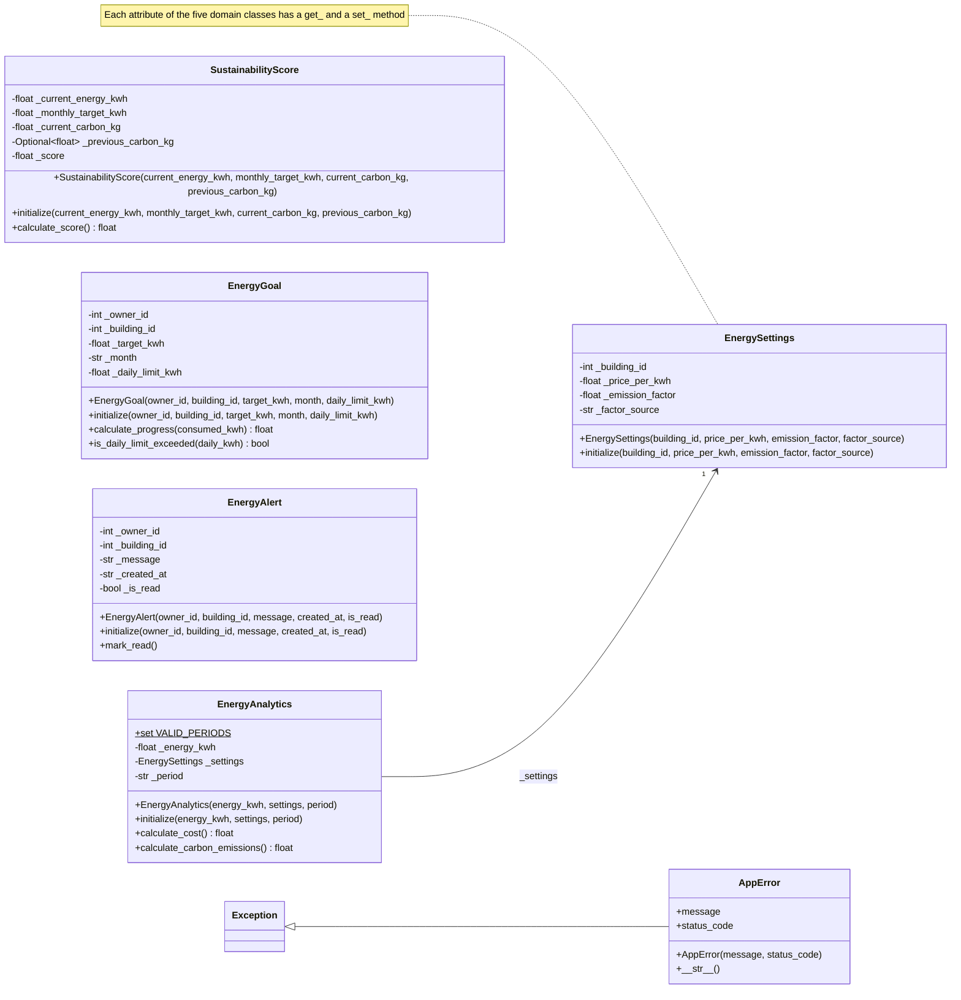

*Picture: `docs/uml/s3_classes.png`. Each attribute of the five domain classes has a `get_` and a `set_` method. The database work is done by functions in `services.py`, which create and use these classes.*

### S4 AI Coach and Reports

| Class | Purpose |
|---|---|
| `DatabaseManager` | saves, lists, reads and deletes reports (table `reports`) |
| `AICoachService` | builds the prompt, calls OpenAI, or gives a built-in tip; remembers where the last tip came from |
| `ReportGenerator` | writes the PDF report with reportlab |
| `Subsystem4Exception` | error type of S4 |

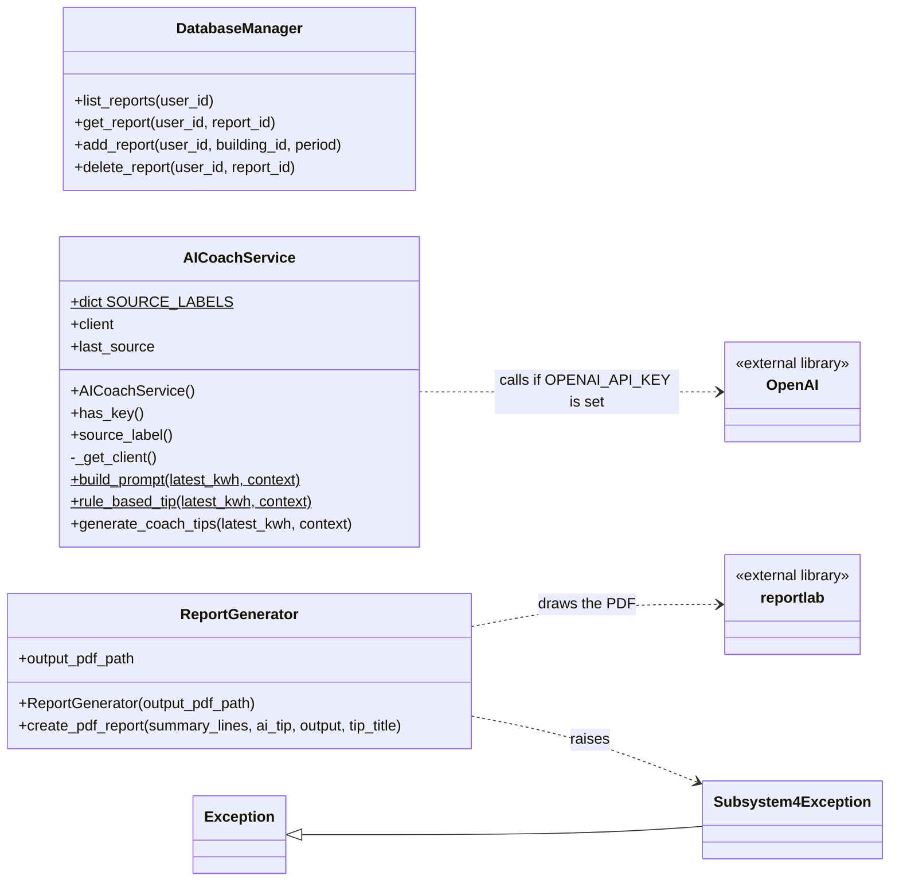

*Picture: `docs/uml/s4_classes.png`. `build_prompt` and `rule_based_tip` are static methods (underlined). The numbers for the coach and the reports are collected by `app/s4/data.py` from S1, S2 and S3.*

## 13. Pages and routes

All pages except login and register need a login; without it the browser is sent to `/login`.

| URL | Method | Subsystem | What it does |
|---|---|---|---|
| `/` | GET | | redirects to the dashboard |
| `/login` | GET, POST | S1 | login page / log in (`?tab=register` shows the register form) |
| `/register` | POST | S1 | create a user and log in |
| `/logout` | POST | S1 | log out |
| `/buildings` | GET | S1 | list of buildings (`?edit=<id>` fills the form for editing) |
| `/buildings/add` | POST | S1 | add a building |
| `/buildings/<id>` | GET | S1 | building details with its devices (`?edit_device=<id>`) |
| `/buildings/<id>/edit` | POST | S1 | edit a building |
| `/buildings/<id>/delete` | POST | S1 | delete a building |
| `/buildings/<id>/devices` | POST | S1 | add a device |
| `/devices/<id>/edit` | POST | S1 | edit a device |
| `/devices/<id>/delete` | POST | S1 | delete a device |
| `/dashboard` | GET | S2 | dashboard (`?building_id=<id>` limits it to one building) |
| `/readings` | GET, POST | S2 | list with filter (`device_id`, `date_from`, `date_to`) / add a reading |
| `/readings/edit/<id>` | GET, POST | S2 | edit a reading |
| `/readings/delete/<id>` | POST | S2 | delete a reading |
| `/readings/export` | GET | S2 | CSV download (same filters as the list) |
| `/readings/simulate` | POST (JSON) | S2 | create one simulated reading |
| `/costs-carbon` | GET | S3 | the S3 page (`?building_id=`, `?month=`) |
| `/coach` | GET, POST | S4 | AI coach page / get a tip (`building_id`, `period`) |
| `/reports` | GET, POST | S4 | list of reports / create a report |
| `/reports/<id>/pdf` | GET | S4 | download the PDF |
| `/reports/<id>/delete` | POST | S4 | delete a report |
| `/health` | GET | S3 | returns `{"status": "ok"}` (no login needed) |

### API of S3

The S3 page uses this JSON API; it needs the login cookie. Errors are returned as `{"error": "..."}` with the status code 400 (bad input), 401 (not logged in) or 404 (not found, or not your building).

| Method and URL | Body or parameters | Result |
|---|---|---|
| `PUT /api/v1/s3/settings/<building_id>` | `price_per_kwh`, `emission_factor`, `factor_source` | saved settings |
| `PUT /api/v1/s3/goals/<building_id>` | `month` (YYYY-MM), `target_kwh`, `daily_limit_kwh` | saved goal |
| `GET /api/v1/s3/analytics/<building_id>` | `period` = day, week or month; `date` | `energy_kwh`, `cost`, `carbon_kg`, prices, period |
| `GET /api/v1/s3/comparison/<building_id>` | `month` | this month against the month before: kWh, cost, carbon, `carbon_reduction_percent` |
| `GET /api/v1/s3/goals/<building_id>/progress` | `month` | `target_kwh`, `consumed_kwh`, `progress_percent`, `remaining_kwh` |
| `GET /api/v1/s3/score/<building_id>` | `month` | `score` (0 to 100) |
| `POST /api/v1/s3/evaluate-alert/<building_id>` | `date` | checks the day against the daily limit; creates an alert if it is too high |
| `GET /api/v1/s3/alerts` | `building_id` (optional) | list of alerts |
| `PATCH /api/v1/s3/alerts/<id>/read` | | mark as read |
| `DELETE /api/v1/s3/alerts/<id>` | | delete |

## 14. Formulas

Money and carbon are rounded to 2 decimals. All energy is in kWh.

| Value | Formula |
|---|---|
| Energy of a building in a period | sum of `amount_kwh` of all readings of all devices of the building |
| Cost | `energy_kwh × price_per_kwh` |
| Carbon (kg CO₂) | `energy_kwh × emission_factor` |
| Goal progress (%) | `consumed_kwh ÷ target_kwh × 100` |
| Remaining | `max(0, target_kwh − consumed_kwh)` |
| Daily alert | created when the energy of one day is **greater than** `daily_limit_kwh` (one alert per day and message) |
| Carbon reduction (%) | `(carbon of month before − carbon this month) ÷ carbon of month before × 100`; empty if the month before is 0 |
| Trend shown by the coach (%) | `(kWh this month − kWh month before) ÷ kWh month before × 100`, 1 decimal; empty if the month before is 0 |
| Average per day (built-in tip) | `energy of the month ÷ 30` |

**Sustainability score** (0 to 100, an illustrative score, not an official certification):

```
usage points  = max(0, 70 × (1 − energy_kwh / target_kwh))
carbon points = 30 × (carbon last month − carbon this month) / carbon last month, limited to 0 … 30
                (if last month has no carbon: 30 points when this month has none either, otherwise 0)
score         = usage points + carbon points, limited to 0 … 100
```

Example: 100 kWh with a price of 0.30 € gives 30.00 €; with an emission factor of 0.40 it gives 40.00 kg CO₂ (this example is tested). The score needs a goal for the month; without a goal the page shows "Set a goal".

The emission factor and the price are **illustrative demo values** (0.40 kg CO₂ per kWh, 0.30 € per kWh) and are labelled "Illustrative demo value". For real use, enter the factor of your electricity supplier or country and write the source in "Factor source".

## 15. Testing

The project has **73 automatic tests** (pytest). They use a fresh temporary database for every test, so they never change your own data, and a fake OpenAI, so they never send real requests.

### Run the tests

```bash
python -m pytest                  # all tests, short output
python -m pytest -v               # verbose: one line per test
python -m pytest -v --tb=short    # verbose with short error messages
python -m pytest -v tests/test_s3_integration.py        # one file
python -m pytest -v -k full_flow  # only tests whose name contains "full_flow"
python -m pytest -v -x            # stop at the first failure
python -m pytest -v -s            # also show print output
```

Result of the last run (executed on the final code): **73 passed**.

### Test files

| File | Tests | What it checks |
|---|---|---|
| `tests/test_s1.py` | 19 | register, login, logout, password hash, duplicate email, bad email, short password, wrong password, login required, add/edit/delete buildings and devices, default comfort temperature, bad input, a second user cannot see or change my building |
| `tests/test_s2_readings.py` | 14 | devices come from S1, add/edit/delete readings, invalid dates and amounts, unknown device, filter and CSV export, live simulation, dashboard numbers (kWh and device count from S1), totals per user and building, readings are deleted with their device or building |
| `tests/test_s2_error_handler.py` | 5 | validation of energy amounts and device ids |
| `tests/test_s3_models.py` | 5 | the S3 classes: getters, setters, validation, cost and carbon with known values (100 kWh), score, goal progress, alerts |
| `tests/test_s3_integration.py` | 8 | login required for page and API, buildings from S1, cost and carbon calculated from S2 readings, error when the price is missing, building must belong to the user, goal progress, score, alert create/read/delete, invalid settings, saved settings are shown |
| `tests/test_s4_integration.py` | 15 | coach uses real usage of the building, "no readings" message, report shows cost and carbon from S3, report without price, PDF download and delete, reports are private, a foreign building is refused, built-in tips and prompt (comfort temperature, no personal data), PDF generator, labels for "no key", "OpenAI works" and "OpenAI fails" (with a fake OpenAI) |
| `tests/test_integration_flow.py` | 5 | every page needs the login, navigation links, **full flow** building → device → reading → settings → goal → analytics → report, users cannot see each other's data, logout |
| `tests/test_env_file.py` | 2 | the `.env` file is read and does not overwrite existing variables |

### Manual end-to-end test (main user journey)

Start the app (`python run.py`) and check each step in the browser:

| # | Step | Expected result |
|---|---|---|
| 1 | Open `/dashboard` without being logged in | You are sent to the login page |
| 2 | Click **Register**, enter name, email, password (8+ characters) | You are logged in and see the Buildings page |
| 3 | Register with the same email again | Error "This email address is already registered." |
| 4 | **Buildings:** add a building (name, address, type, comfort temperature) | The building appears in the list |
| 5 | Open the building, add two devices | Devices appear in the table |
| 6 | **Readings:** add a reading (device, today, 12.5 kWh) | The reading appears in the table |
| 7 | Enter a negative amount or an invalid date | An error message is shown, nothing is saved |
| 8 | Filter by device and date; click **Export CSV** | The list is filtered; a CSV file is downloaded |
| 9 | Click **Start** in *Live simulation*, wait 20 seconds, click **Stop** | New rows marked "Simulated" appear |
| 10 | **Dashboard** | Total kWh, device count, chart and tables match the readings |
| 11 | **Costs & Carbon:** save price 0.30 and factor 0.40, then a goal (300 kWh, daily limit 10 kWh), click **Load** | Energy, cost (= kWh × 0.30), carbon (= kWh × 0.40), score and goal progress are shown |
| 12 | Choose a daily limit below one day's kWh, click **Check this day** | An alert appears; **Mark read** and **Delete** work |
| 13 | **AI Coach:** choose building and month, click **Get saving tips** | A tip with a label (OpenAI, built-in, or "could not be reached") |
| 14 | **Reports:** create a report, click **Open PDF** | A PDF with building, period, kWh, cost, carbon, goal, score and the tip |
| 15 | Log out, register a second user | The second user sees none of the first user's buildings, readings or reports |
| 16 | Open `/readings/edit/1` or `/reports/1/pdf` as the second user | "Reading does not exist" / "Not found" |
| 17 | Narrow the browser window to phone width | The navigation wraps; there is no sideways scrolling |

Checked by script on the final code: all eight pages have no horizontal scrolling at 390 px width, and with 1,000 readings every page was produced by the server in under 30 ms.

## 16. Requirements status

These are the requirements that are implemented in the final project. Each one is covered by a test or by a check described in [Testing](#15-testing). The IDs are the numbers from the first presentation.

### S1 User and Building Management: 19 requirements

| ID | Requirement | Status | Note |
|---|---|---|---|
| S1-F1 | Register with name, email, password | Done | |
| S1-F2 | Log in and log out | Done | |
| S1-F4 | Add a building (name, address, type) | Done | |
| S1-F5 | Comfort temperature of a building | Done | used by the AI coach and the PDF report |
| S1-F6 | Edit and delete own buildings | Done | |
| S1-F7 | Add devices (name, energy type) | Done | |
| S1-F8 | Edit and delete own devices | Done | |
| S1-F9 | List of all buildings and devices | Done | buildings list; devices on the building page |
| S1-F10 | No duplicate email | Done | |
| S1-N1 | Passwords stored as hashes | Done | tested |
| S1-N2 | Email only once | Done | `UNIQUE` column and a check |
| S1-N3 | Only own buildings and devices | Done | tested (404 for foreign ids) |
| S1-N4 | Clear messages for wrong input | Done | tested |
| S1-N5 | Pages load in under 2 seconds | Done | measured on the server: under 30 ms per page with 1,000 readings |
| S1-N6 | Data survives a restart | Done | SQLite file |
| S1-N7 | Secret key from an environment variable | Done | `SECRET_KEY`; a development default is used if it is not set |
| S1-N8 | Works on phone and PC | Done | checked at 390 px width, no sideways scrolling |
| S1-N9 | Login and access rules tested | Done | 19 tests |
| S1-N10 | Small functions with short comments | Done | |

### S2 Energy Monitoring and Dashboard: 17 requirements

| ID | Requirement | Status | Note |
|---|---|---|---|
| S2-F1 | Add a reading | Done | |
| S2-F2 | List of readings | Done | |
| S2-F3 | Edit a reading | Done | |
| S2-F4 | Delete a reading | Done | |
| S2-F5 | Filter by date range and device | Done | |
| S2-F6 | Total per day | Done | table and chart |
| S2-F7 | Total per week and month | Done | tables |
| S2-F10 | CSV export | Done | |
| S2-N1 | Only valid dates and positive numbers | Done | tested |
| S2-N2 | Each reading belongs to one device and one owner | Done | owner through device and building |
| S2-N3 | Dashboard under 3 seconds for 1,000 readings | Done | measured on the server: under 10 ms |
| S2-N4 | Charts have title, axis labels, units | Done | heading above the chart, axis titles "Date" and "Energy (kWh)" |
| S2-N5 | Same data gives the same totals | Done | tested |
| S2-N6 | Friendly message without data | Done | |
| S2-N7 | Energy always in kWh | Done | |
| S2-N8 | Simulated readings are marked | Done | |
| S2-N10 | Only own readings | Done | tested |

### S3 Cost, Savings, Carbon and Score: 14 requirements

| ID | Requirement | Status | Note |
|---|---|---|---|
| S3-F1 | Price and emission factor per building | Done | |
| S3-F4 | Carbon = kWh × factor | Done | tested |
| S3-F6 | Sustainability score 0 to 100 | Done | |
| S3-F7 | Monthly goal and progress in percent | Done | |
| S3-F9 | View, mark as read, delete alerts | Done | on the Costs & Carbon page |
| S3-F10 | Clear error if price or factor is missing | Done | tested |
| S3-N3 | Missing price or factor gives an error, no guess | Done | tested |
| S3-N4 | Calculations tested with known examples | Done | 100 kWh × 0.30 = 30.00; 100 kWh × 0.40 = 40 kg |
| S3-N5 | Values rounded to 2 decimals | Done | |
| S3-N6 | Units are compatible | Done | |
| S3-N7 | Goals, alerts, scores only for the owner | Done | tested |
| S3-N8 | Invalid input is rejected | Done | tested |
| S3-N9 | Changing price or factor keeps old readings | Done | readings are stored separately in S2 |
| S3-N10 | Formulas explained in code comments | Done | |

### S4 AI Coach and Reports: 9 requirements

| ID | Requirement | Status | Note |
|---|---|---|---|
| S4-F1 | Button to get AI tips | Done | |
| S4-F7 | PDF report (period, kWh, cost, carbon, score, summary) | Done | tested |
| S4-F8 | Download the PDF | Done | |
| S4-N1 | API key from an environment variable | Done | `OPENAI_API_KEY` or `.env`; never in the code |
| S4-N2 | Clear message for network error, missing key, limits | Done | the three labels in [section 7](#7-ai-coach-and-the-openai-key) |
| S4-N5 | Reports contain only the user's data | Done | tested |
| S4-N8 | PDF is clean and easy to read | Done | simple text layout |
| S4-N9 | Tests use a fake OpenAI | Done | |
| S4-N10 | Logs never contain the API key | Done | the application does not log the key |

## 17. Security

- **Passwords** are stored only as hashes (werkzeug); the plain password is never stored.
- **Access control:** every page except login and register needs a login. Every database query for readings, settings, goals, alerts and reports is limited to the logged-in user (through `devices → buildings → user_id` or `owner_id`). Foreign ids return 404. This is tested with two users.
- **SQL injection:** all queries use `?` parameters, never text built from user input.
- **Secrets:** the OpenAI key and the secret key come from environment variables or `.env`. `.env` and `*.db` are in `.gitignore`, so keys and the database file are not uploaded. Set your own `SECRET_KEY` outside of development.
- **Privacy towards OpenAI:** only building type, comfort temperature, kWh, trend and goal progress are sent. No name, email or address.
- **Pages are escaped** by Jinja2 (protection against injected HTML).
- Not included (MVP): CSRF tokens for forms, login rate limiting, HTTPS (use a reverse proxy for a real deployment).

## 18. Known limitations and future improvements

Limitations:
- No profile page; no password reset.
- The AI coach gives one short tip (maximum 60 tokens) and does not keep a history.
- The price and carbon factor must be entered by the user; the demo values are not official.
- The simulation creates readings for one device at a time; the dashboard needs a reload to show them.
- Reports are monthly and are calculated again on every download (they are not stored as files).
- S2 also contains the classes `EnergyReading`, `ReadingManager` and `Dashboard`; the website pages use the functions in `models/energy_reading.py` and the class `Statistics`; the classes `ReadingManager` and `Dashboard` are not called by the pages and have no tests of their own.
- Development server (`python run.py`); for a real deployment use a production server (for example gunicorn).

Possible improvements:
- AI tip history with dates, a question box, weekly summaries and a daily request limit.
- Automatic alerts when a reading is added; savings and carbon reduction shown on the S3 page.
- Chart per device; live update of the dashboard.
- Profile editing, password reset, CSRF protection.
- Real emission factors by country and supplier.

## 19. Troubleshooting

| Problem | Solution |
|---|---|
| `pip` or `python` is not found | Install Python 3.12 or newer and tick "Add Python to PATH"; or use `py -m pip` and `py run.py` on Windows |
| `ModuleNotFoundError: No module named 'app'` or `flask` | Open the terminal in the folder that contains `run.py` and run `pip install -r requirements.txt` |
| Port 5000 is already in use | Stop the other program, or change `port=5000` in `run.py` |
| The AI coach says "No OpenAI key is set" | Check that the file is named `.env` (not `.env.txt`), is in the same folder as `run.py`, and that the app was restarted after saving it |
| The AI coach says "OpenAI could not be reached" | Check the key (copied completely), the API credit on platform.openai.com ("You have no credits remaining" is a common reason), and the internet connection |
| A page looks old after a code change | Stop the server with `Ctrl + C` and start it again |
| I want to start with an empty database | Stop the app and delete `energy.db` (and run `python seed_demo.py` again if you want the demo data) |
| `seed_demo.py` says the demo data already exists | It was created before; log in with demo@example.com / demo12345 |
| Charts are empty | The chart needs readings; add some under **Readings** or run `python seed_demo.py` |

## 20. Screencast and presentation

- **Screencast:** [add the link here]
- **Presentation:** [add the link or the file path here, for example `presentation/`]

---

*AI-Powered Smart Energy Management System: Python Capstone Project, FH Dortmund.*
