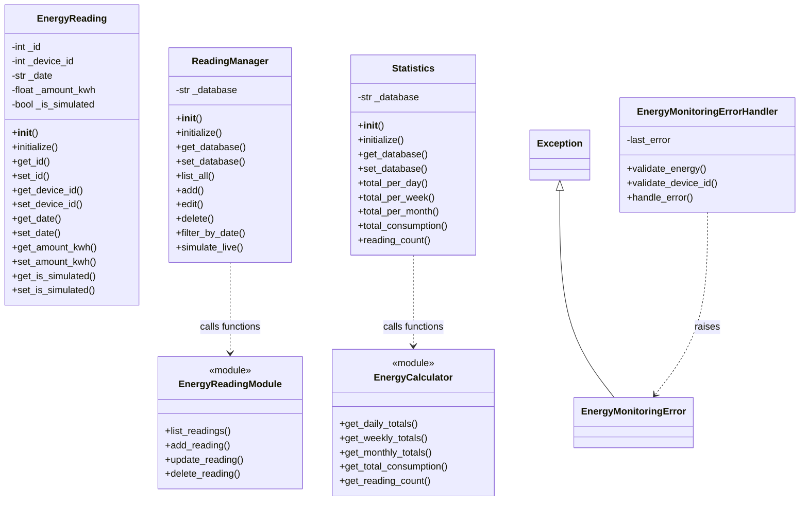

# AI-Powered Smart Energy Management System — Subsystem 2

## 1. Overview

Subsystem 2 is responsible for Energy Monitoring and Dashboard functionality within the AI-Powered Smart Energy Management System.

It is developed using Python, Flask, SQLite, HTML, and CSS.

The subsystem allows users to manage energy readings, monitor consumption, view statistics, and simulate energy data.

## 2. Main Features

- Energy reading management (Create, Read, Update, Delete).
- Daily, weekly, and monthly energy consumption statistics.
- Total energy consumption calculation.
- Reading count statistics.
- Energy consumption dashboard.
- Filtering readings by device and date.
- CSV export functionality.
- Simulated live energy readings.
- Input validation and error handling.

## 3. Main Classes

- **EnergyReading:** Represents and validates individual energy readings.
- **ReadingManager:** Manages energy reading operations, including CRUD, filtering, and simulation.
- **Statistics:** Provides daily, weekly, and monthly energy consumption statistics.
- **EnergyMonitoringError:** Custom exception for energy monitoring errors.
- **EnergyMonitoringErrorHandler:** Validates input data and handles monitoring errors.

Additional modules support database operations, calculations, and dashboard functionality.

## 4. Technologies

- Python
- Flask
- SQLite
- HTML
- CSS
- Pytest

## 5. Project Structure

- `models/` — Energy reading models and database operations.
- `services/` — Reading management, statistics, and calculation services.
- `routes/` — Flask application routes.
- `dashboard/` — Dashboard functionality.
- `templates/` — HTML templates.
- `static/` — CSS and static files.
- `tests/` — Automated tests.

## 6. UML Class Diagram

The following diagram shows the main classes, modules, and their dependencies in Subsystem 2.




## 7. Installation and Running

Create a virtual environment:

```bash
python -m venv .venv
```

Activate it on Windows:

```powershell
.venv\Scripts\activate
```

Install dependencies:

```bash
pip install -r requirements.txt
```

Run the application:

```bash
python app.py
```

Open the application:

http://127.0.0.1:5000

## 8. Running Tests

Run the automated tests:

```bash
python -m pytest -q
```

## 9. Team Information

Add the team members and their assigned subsystems here.

## 10. Video Presentation

The team presentation video (3–5 minutes) will be available here:

[Insert team video link here]

## 11. Integration Note

`demo_devices` currently provides temporary sample data for independent Subsystem 2 development.

During integration with Subsystem 1, Subsystem 2 should reference the actual devices table and use the authenticated user's ownership context.

Subsystem 2 does not implement Subsystem 1 login or building management.

